<p align="center">
  
</p>

<h1 align="center">NetCopilot</h1>

<p align="center">
  <strong>The SSH client for network engineers — with an AI copilot that asks first.</strong><br />
  SSH, Telnet and Serial in one modern app. ARIA reads your sessions, finds the root cause,<br />
  and suggests the fix. Nothing changes on a device until you approve it.
</p>

<p align="center">
  <a href="https://github.com/AnasProgrammer2/netcopilot/releases/latest"></a>
  <a href="https://github.com/AnasProgrammer2/netcopilot/releases"></a>
  <a href="https://github.com/AnasProgrammer2/netcopilot/stargazers"></a>
  
  <a href="./LICENSE"></a>
</p>

<p align="center">
  <a href="https://github.com/AnasProgrammer2/netcopilot/releases/latest"><b>Download</b></a> ·
  <a href="https://netcopilot.app">Website</a> ·
  <a href="#how-aria-stays-safe">How ARIA stays safe</a> ·
  <a href="#features">Features</a> ·
  <a href="#compared-to">Compared to</a> ·
  <a href="https://www.linkedin.com/company/netcopilot/">LinkedIn</a>
</p>

<p align="center">
  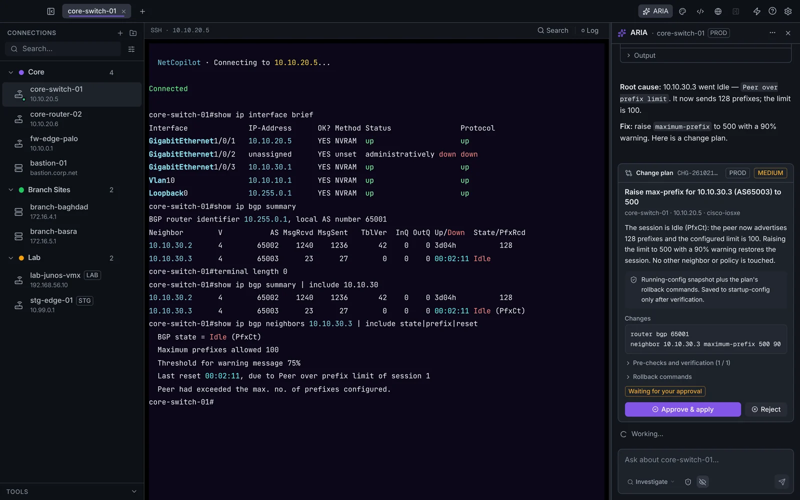
</p>

<!-- DEMO VIDEO: to update it, edit this file on github.com, drag the new .mp4 onto the line below,
     and delete the old link. GitHub uploads it and turns the link into a video player. -->
https://github.com/user-attachments/assets/1be0a1d5-f7a2-45c8-b667-1f49f356d0f3

---

## Why NetCopilot

- **A complete, free SSH client.** Sessions, SFTP, port forwarding, jump hosts, serial consoles, snippets and an encrypted vault — no trial clock, no account required. The AI is optional.
- **An AI copilot built for network gear.** ARIA knows Cisco, Juniper, Arista, Palo Alto, Fortinet, MikroTik and more. It runs the read-only checks a senior engineer would, and tells you *why* — not just what.
- **Changes only when you say so.** ARIA suggests a plan with the exact lines and a way back. NetCopilot applies it with the device's own undo timer, and you keep it or roll it back with one click.
- **Private by default.** Everything is encrypted on your machine. Bring your own Claude, OpenAI or Grok key — or run a local model with Ollama, and nothing leaves your network.

## Quick start

1. **[Download](https://github.com/AnasProgrammer2/netcopilot/releases/latest)** for macOS (Apple Silicon & Intel, signed and notarized), Windows (installer or portable) or Linux (AppImage or .deb).
2. Add a host — or import your `~/.ssh/config` or a Termius CSV export in one step.
3. Connect. When you want a second pair of eyes, open **ARIA** (`⌘⇧A` / `Ctrl+Shift+A`) and describe the problem.

NetCopilot updates itself from then on: new versions download in the background and install when you restart.

---

## Meet ARIA

<p align="center">
  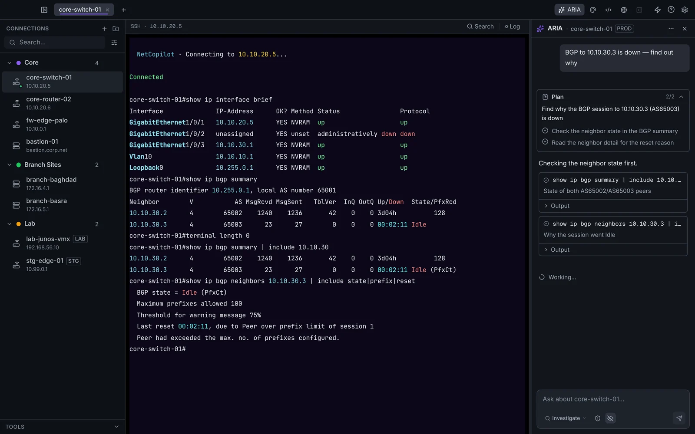
</p>

Describe the problem in plain words — *"BGP to 10.10.30.3 is down, find out why"*. ARIA:

1. **Plans** the investigation before touching anything
2. **Checks** with read-only commands, each one visible in the chat and in your terminal
3. **Reads** all the output together, with the device's vendor and context in mind
4. **Explains** the root cause and, if a fix is needed, **suggests a change plan**

ARIA carries a playbook per platform — the signature commands, the common root causes and the right order to isolate a fault. On a Cisco ASA it reaches for `packet-tracer`, on a FortiGate `diagnose debug flow`, on Palo Alto `test security-policy-match`.

<table>
  <tr>
    <td width="50%" valign="top">
      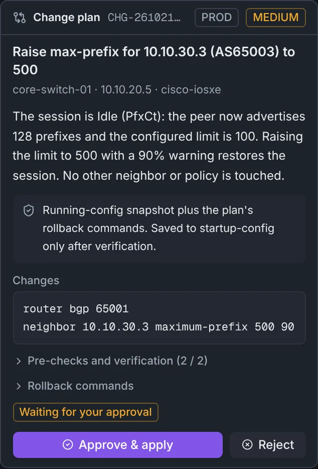<br />
      <b>It suggests the fix.</b> Evidence, every line it wants to change, how the result is checked and how to undo it. Nothing runs until you click <b>Approve</b>.
    </td>
    <td width="50%" valign="top">
      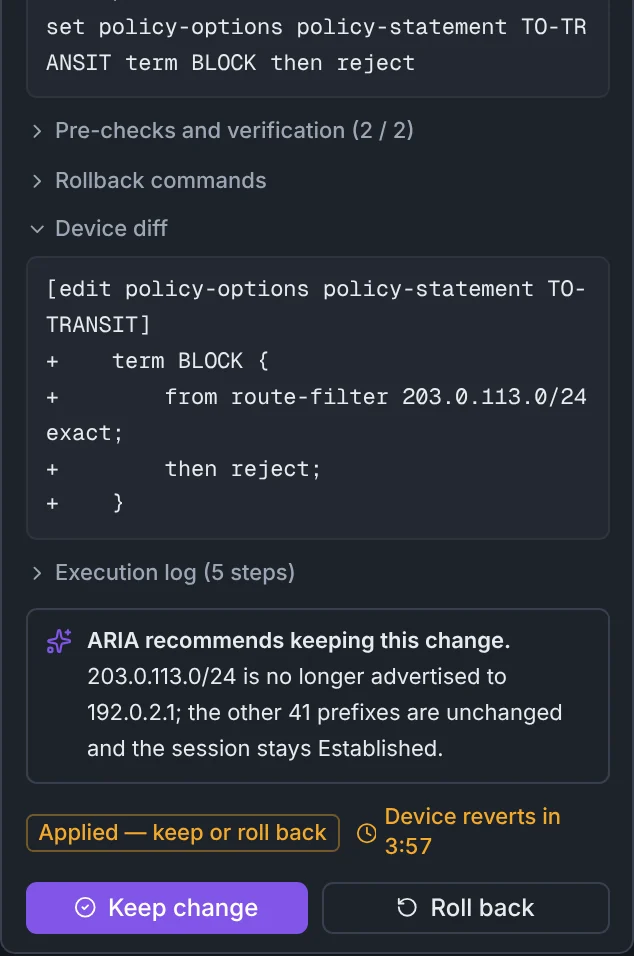<br />
      <b>You keep it — or undo it.</b> Before and after side by side, with ARIA's read of the result. If your connection drops, the device rolls back by itself.
    </td>
  </tr>
</table>

---

## How ARIA stays safe

ARIA's own commands are **read-only in every mode**. It cannot change a device with a command at all — every change goes through a plan you review.

| Mode | What ARIA can do |
|:---|:---|
| **Investigate** (default) | Read-only diagnosis — `show`, `display`, `ping`, `traceroute`. Long-running commands (`show tech`, captures) ask first |
| **Change** | Suggests change plans. Nothing touches the device until you click **Approve** |
| **Autopilot** | Lab and staging devices only — ARIA may approve and confirm its own plans, with the same safety nets. Never on production |

Every connection is marked **Production**, **Staging** or **Lab**. The change policy can keep production read-only, or require a written reason for changes outside a maintenance window.

**When you approve a plan, NetCopilot:**

1. **Snapshots** the running configuration (encrypted, inside NetCopilot)
2. Runs the **pre-checks** to record a baseline
3. Arms the **device's own safety net** — Junos `commit confirmed`, Arista EOS config session `commit timer`, Cisco IOS `reload in` when the management path is touched, NX-OS checkpoint, RouterOS Safe Mode
4. **Applies** the change — if the device rejects a line, it is backed out right away
5. **Verifies** with the same checks; ARIA compares before and after
6. Waits for **your click**: keep it or roll it back

| Guardrail | What it does |
|:---|:---|
| **Blocked commands** | `reload`, `write erase`, `rm -rf` and your own patterns never run, and are screened in every plan |
| **Clicks for anything unusual** | Commands on another device, long-running commands and anything Auto Watch suggests wait for you |
| **Untrusted device output** | Output reaches the model marked as data, so a banner or log line can't instruct ARIA |
| **Change History** | Every plan — approved, rejected, rolled back or failed — with the diff and full execution log, exportable as Markdown for change tickets |

<p align="center">
  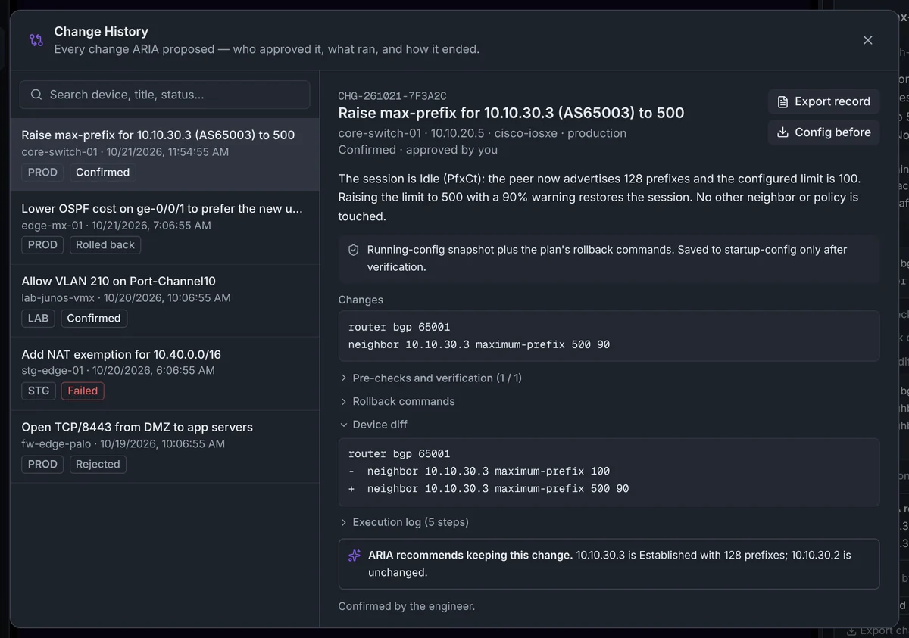
</p>

---

## Features

<table>
  <tr>
    <td width="50%" valign="top">
      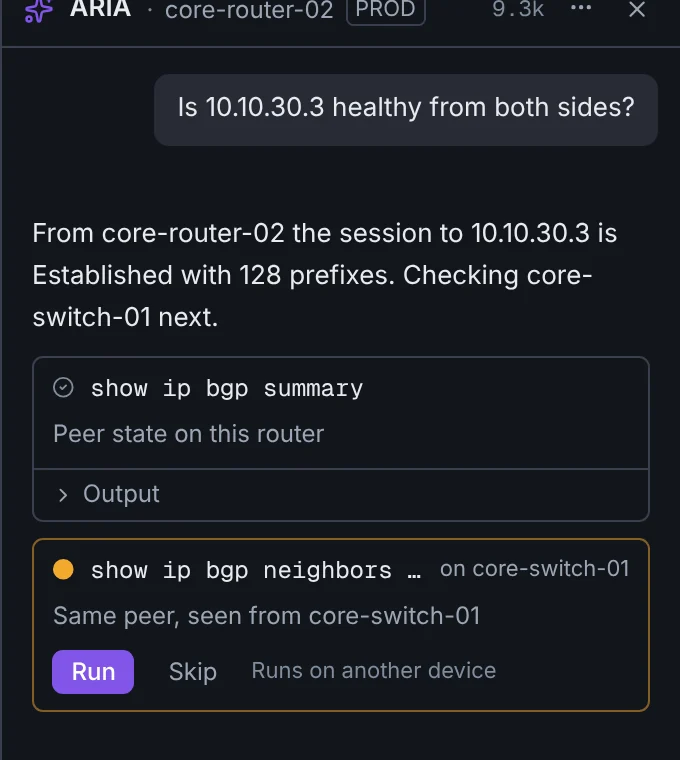<br />
      <b>One copilot, every session.</b> ARIA sees all your open sessions and connects what it finds across devices. A command meant for another device waits for your <b>Run</b>.
    </td>
    <td width="50%" valign="top">
      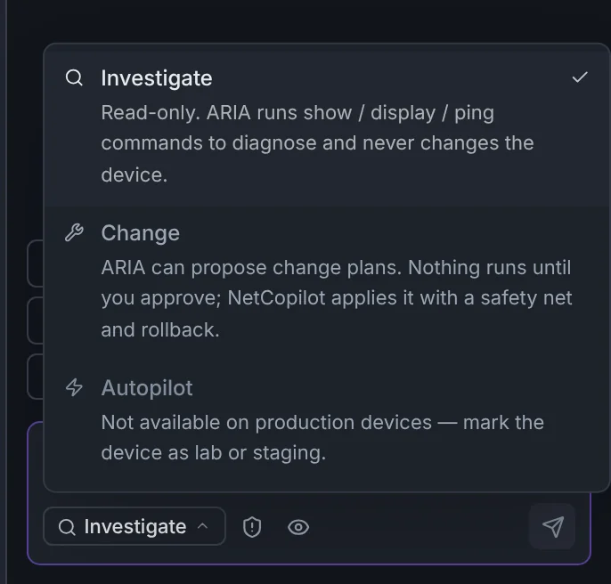<br />
      <b>You decide how much ARIA can do.</b> Investigate by default, Change when you want a fix, Autopilot only in the lab.
    </td>
  </tr>
</table>

<p align="center">
  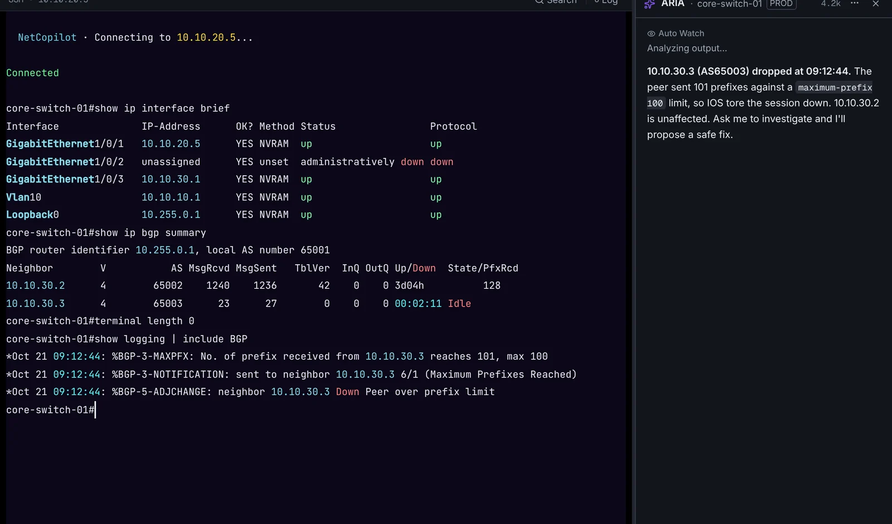
</p>

**Auto Watch reads along.** When a command finishes, ARIA reads the output and points out what looks wrong — in the side panel, without touching your session. Even with the panel closed, a badge appears when an error like `%Error` or `connection refused` shows up.

<table>
  <tr>
    <td width="50%" valign="top">
      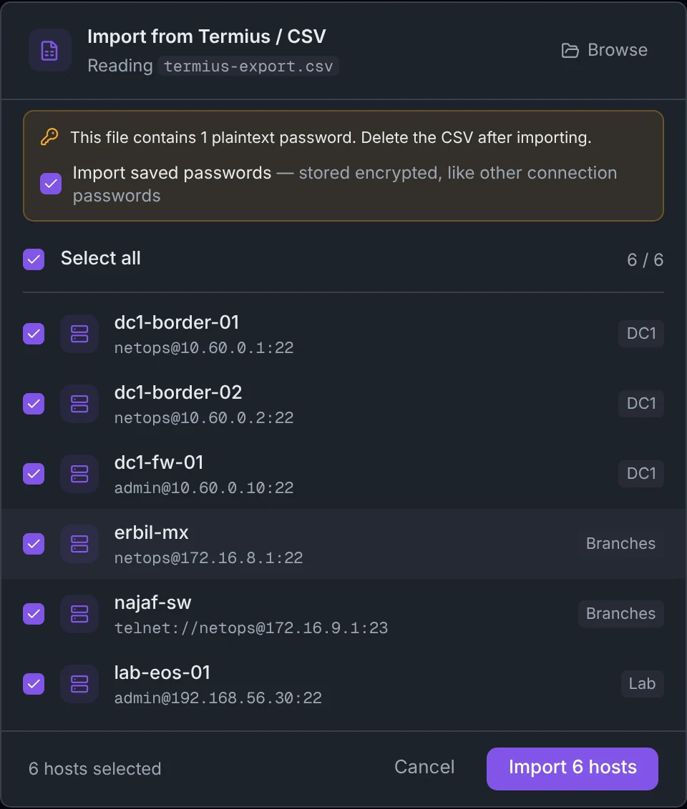<br />
      <b>Bring your hosts with you.</b> Import from <code>~/.ssh/config</code> or a Termius CSV export — groups, tags and jump hosts included.
    </td>
    <td width="50%" valign="top">
      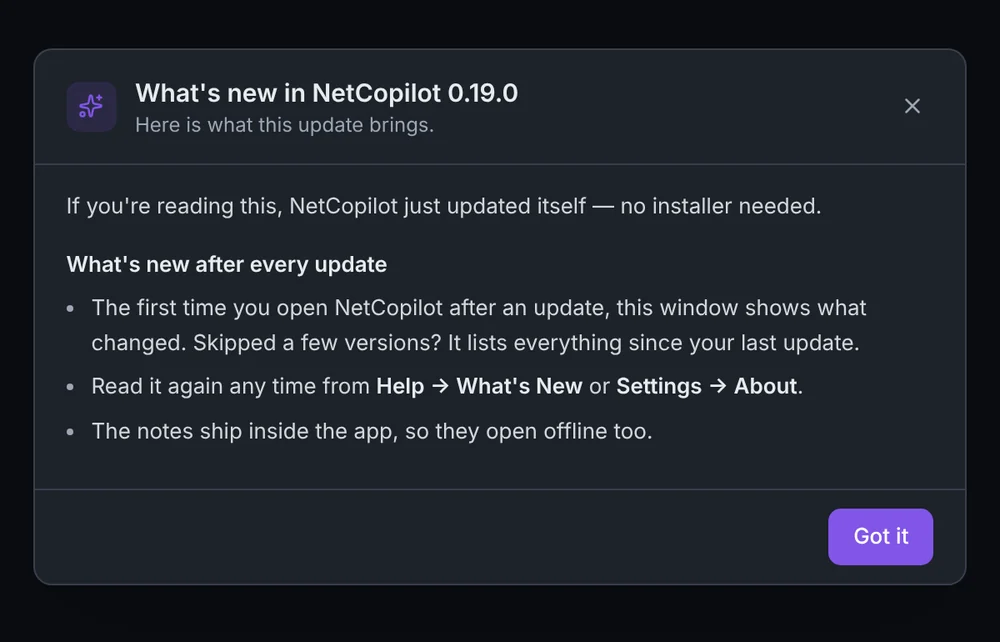<br />
      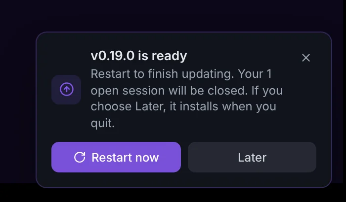<br />
      <b>Updates itself.</b> New versions download in the background and install on restart — then show you what changed.
    </td>
  </tr>
</table>

### Everything a daily driver needs

| | |
|:---|:---|
| **Protocols** | SSH (password, key, key + passphrase, Cisco enable), Telnet with NAWS resize, Serial (RS-232 / USB, baud, parity, data and stop bits, flow control) |
| **Terminal** | xterm.js with true color, vendor-aware highlighting on connect, regex search with a live `n / total` counter, split view, session logging with optional timestamps, auto-reconnect |
| **Files** | SFTP browser in its own tab — browse, upload, download, rename, delete, create folders |
| **Networking** | Jump host / bastion, local and remote port forwarding, SOCKS proxy (dynamic forwarding), agent forwarding |
| **Connections** | Groups, colors, tags and notes; Quick Connect (`⌘K`) for `user@host:port`; startup commands; reusable SSH keys; health monitor with live latency |
| **Import / export** | `~/.ssh/config`, Termius or generic CSV, full export as AES-256 encrypted JSON |

### Supported devices

| Category | Platforms |
|:---|:---|
| Cisco | IOS, IOS-XE, NX-OS, ASA |
| Routing & switching | Juniper Junos, Arista EOS, Nokia SR OS, Huawei VRP, MikroTik RouterOS, HPE Aruba ProCurve |
| Firewalls | Palo Alto PAN-OS, Fortinet FortiOS |
| Load balancers | F5 BIG-IP TMOS |
| Servers | Linux / Unix, Windows Server |
| Anything else | Any SSH, Telnet or Serial device — the type is detected on first login |

Missing your platform? [Request vendor support](https://github.com/AnasProgrammer2/netcopilot/issues/new?template=vendor_support.yml).

---

## Bring your own AI — or none at all

ARIA runs on a NetCopilot license (hosted Claude), your own API key, or a model you host yourself. **Settings → ARIA**:

| Provider | What you need | Example models |
|---|---|---|
| **Claude** | Anthropic API key | `claude-opus-5-5`, `claude-sonnet-5-5`, `claude-haiku-5-5` |
| **OpenAI** | OpenAI API key | `gpt-4.1`, `gpt-5` |
| **Grok** | xAI API key | `grok-4` |
| **Local / custom** | Any OpenAI-compatible URL — Ollama (`http://localhost:11434/v1`), LM Studio (`http://localhost:1234/v1`), vLLM, LocalAI | `qwen2.5:14b`, `llama3.1:8b` |

With your own provider, requests go straight from the app to that provider or server — never through NetCopilot servers. API keys live in the OS keychain. For local models, pick one with tool calling and a context window of 16K tokens or more.

---

## Compared to

| | NetCopilot | Termius | SecureCRT | PuTTY |
|:---|:---:|:---:|:---:|:---:|
| Price | **Free** | Free · Pro from $10/mo | Paid | Free |
| SSH, Telnet & Serial | ✅ | ✅ | ✅ | ✅ |
| SFTP browser | ✅ | ✅ | ✅ | CLI only |
| Jump host | ✅ | ✅ | ✅ | Manual |
| AI that troubleshoots network devices | ✅ | — | — | — |
| Change plans with device-side rollback | ✅ | — | — | — |
| Bring your own AI key or a local model | ✅ | — | — | — |
| Session logs | ✅ | Pro | ✅ | ✅ |
| Source available | ✅ | — | — | ✅ |

Need cloud sync across devices or mobile apps? Termius does that well, and NetCopilot doesn't (yet). NetCopilot is built for the engineer at the desk with a console cable and a production network to look after.

---

## Security & privacy

| Layer | Protects | Technology |
|:---|:---|:---|
| **Encrypted database** | Connections, settings, change snapshots | SQLCipher (AES-256) |
| **OS keychain** | Passwords, SSH keys, API and license keys, the database key | Electron `safeStorage` |
| **Master password** | Optional app lock, with auto-lock when idle | scrypt, timing-safe comparison |
| **Blocked commands** | Destructive commands, in every mode | Enforced in code, always on |

Credentials are never stored in plaintext. The database key is generated on first launch and kept in the OS keychain. The source is open to read, so you can check all of this yourself. Found an issue? See [SECURITY.md](./SECURITY.md).

---

## Who it's for

- **Network engineers** working with Cisco, Juniper, Arista, Palo Alto, Fortinet and MikroTik every day
- **NOC teams** that need fast, consistent first-line diagnostics
- **Infrastructure and DevOps teams** managing Linux and Windows servers
- **Security teams** running audits and configuration reviews
- Anyone who lives in SSH sessions and wants an assistant that knows when to ask

<details>
<summary><b>Keyboard shortcuts</b></summary>

| Shortcut | Action |
|:---|:---|
| `⌘K` / `Ctrl+K` | Quick Connect |
| `⌘T` / `Ctrl+T` | New tab |
| `⌘W` / `Ctrl+W` | Close tab |
| `⌘,` / `Ctrl+,` | Settings |
| `⌘D` / `Ctrl+D` | Split view |
| `⌘⇧A` / `Ctrl+Shift+A` | ARIA panel |
| `⌘1–9` / `Ctrl+1–9` | Switch to tab N |
| `⌘F` / `Ctrl+F` | Search in terminal |

</details>

<details>
<summary><b>Build from source</b></summary>

Requires [Node.js](https://nodejs.org/) 20+, npm 9+ and Git.

```bash
git clone https://github.com/AnasProgrammer2/netcopilot.git
cd netcopilot
npm install
npm run dev          # launches with hot reload
```

```bash
npm run build:mac    # macOS
npm run build:win    # Windows
npm run build:linux  # Linux
```

Packages land in `dist/`. Run the checks with `npm run typecheck` and `npx vitest run`.

| Layer | Technology |
|:---|:---|
| App | Electron 44, electron-vite |
| UI | React 19, Tailwind CSS, Zustand |
| Terminal | xterm.js 6 |
| Storage | SQLite with SQLCipher (AES-256) via better-sqlite3-multiple-ciphers |
| Protocols | ssh2, serialport, raw TCP (Telnet) |
| AI | NetCopilot API, or Claude / OpenAI / Grok / any OpenAI-compatible server |

</details>

---

## Contributing

Bug reports, vendor playbooks and pull requests are welcome. Start with [CONTRIBUTING.md](./CONTRIBUTING.md), then open an [issue](https://github.com/AnasProgrammer2/netcopilot/issues/new/choose) to discuss bigger changes.

**If NetCopilot saves you time on a bad day, a ⭐ helps other engineers find it.**

<a href="https://star-history.com/#AnasProgrammer2/netcopilot&Date">
  
</a>

---

## License

**Business Source License 1.1** — the source is fully visible, so you can verify NetCopilot never exfiltrates your credentials, configs or keys.

| | |
|:---|:---|
| Read and learn from the code | ✅ Free |
| Personal use | ✅ Free, unlimited |
| Academic and research use | ✅ Free |
| Internal evaluation | ✅ Free |
| Commercial use | License required — [support@netcopilot.app](mailto:support@netcopilot.app) |
| Change date | January 1, 2029 → Apache 2.0 |

See [LICENSE](./LICENSE) for the full text.

## Acknowledgments

- macOS code signing and notarization through the [Apple Developer Program](https://developer.apple.com)
- Windows code signing requested from the [SignPath Foundation](https://signpath.org/), with signing by [SignPath.io](https://signpath.io/)
- Built on [Electron](https://www.electronjs.org/), [React](https://react.dev/), [xterm.js](https://xtermjs.org/), [ssh2](https://github.com/mscdex/ssh2), [better-sqlite3-multiple-ciphers](https://github.com/m4heshd/better-sqlite3-multiple-ciphers) and the [Anthropic Claude](https://www.anthropic.com/) API

<p align="center">
  <sub>Built for the engineers who keep networks running · <a href="https://netcopilot.app">netcopilot.app</a> · <a href="https://www.linkedin.com/company/netcopilot/">LinkedIn</a></sub>
</p>
